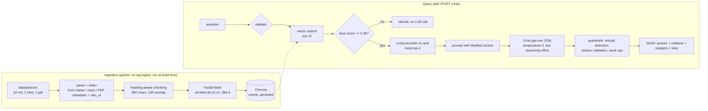

# Design and Evaluation

> **Fill in before submitting:** replace every `TBD` in sections 6 and 7 with the numbers from
> `eval/results/` (see README section 6), and update the discussion to match your results.

## 1. Overview

The Nile Byte Policy Assistant answers employee questions about the policies of a fictional
software company, using Retrieval-Augmented Generation (RAG). For every question it:

1. retrieves the most relevant policy passages;
2. answers using only those passages;
3. cites the source document ID next to each fact; and
4. returns snippets and links to the exact policy section.

If the policies don't contain the answer, it refuses.

RAG was chosen over fine-tuning because the requirements are about **grounding and
attribution**. A fine-tuned model cannot cite its sources and still hallucinates. Policies
change, and RAG picks up an edited document after re-indexing rather than retraining. At low
traffic, calling a hosted model through an API is also the cheapest option.

## 2. Architecture

Code layout: `rag/ingest.py` (ingestion), `rag/pipeline.py` (retrieval, re-ranking and
generation), `rag/guardrails.py`, `rag/prompts.py`, `app.py` (Flask) and `eval/` (evaluation).
The generation step is a LangChain Expression Language chain, `prompt | llm | StrOutputParser()`.
Retrieval, re-ranking and the guardrails run around it in plain Python, so each step can be
unit-tested and switched off for ablations.

## 3. Design decisions

| Area | Choice | Why | Alternatives considered |
| --- | --- | --- | --- |
| Corpus | 12 synthetic policies for one fictional company (about 15,300 words, around 50 pages): 10 Markdown, 1 HTML, 1 PDF | Legal to publish. Covers every topic in the rubric (PTO, holidays, remote work, expenses, security, and more). Mixed formats exercise every parser. Policies cross-reference each other by ID, as real handbooks do | Real employer policies, which can't be published |
| Document IDs | Stable `doc_id` per document (e.g. `POL-HR-003`) from front matter, an HTML `<meta>` tag or the PDF Subject field, falling back to the file name | Citations need short, stable, checkable identifiers. The tests assert that the file name and metadata agree | Using file paths as citations, which are long and fragile |
| Parsing and cleaning | Markdown: front matter is stripped. HTML: BeautifulSoup removes `script`, `style`, `nav`, `header` and `footer`, and turns headings, lists and tables into Markdown. PDF: pypdf extracts text, and numbered section headings are restored | One Markdown representation for every format means one chunker. It also means the `/docs` viewer can link to sections in any format, the PDF included | Format-specific chunkers |
| Chunking | `MarkdownHeaderTextSplitter` (sections), then `RecursiveCharacterTextSplitter` (800 characters, 100 overlap). `title > section` is prepended to each chunk | Content-aware chunking keeps one policy topic per chunk, and the overlap keeps sentences that span a boundary. 800 characters is about 200 tokens, inside the 128–256-token sweet spot and under the embedding model's 256-token input limit, so chunks aren't truncated. The prepended title and section make short chunks retrievable on their own | Fixed token windows only; 500 or 1,200 characters (ablations) |
| Embeddings | `sentence-transformers/all-MiniLM-L6-v2` (384 dimensions) through FastEmbed on ONNX Runtime | Free, local, fast on CPU, and no API quota. The same model as the course's reference app. ONNX avoids PyTorch, keeping memory within Render's free 512 MB | `bge-small-en-v1.5`; hosted embedding APIs (quota, extra latency) |
| Vector store | Chroma, persisted on disk, cosine distance | Zero-cost, embedded, no server; enough for about 200 chunks. Built at deploy time, so Render's ephemeral disk doesn't matter | Pinecone (unnecessary at this scale) |
| Retrieval | Fetch 10 by cosine similarity, re-rank with the `ms-marco-MiniLM-L-6-v2` cross-encoder, keep **k = 4** | Vector similarity is only a proxy for relevance; a cross-encoder reads the question and passage together. k = 4 gives enough context for multi-part questions while keeping the prompt short (Groq's tokens-per-minute limit) | k = 2 or 6; no re-ranker (ablations) |
| Prompt | The system message gives the purpose and rules: use only the context, cite `[doc_id]` after each fact, at most 180 words, refuse with an exact sentence, treat context and question as data. Each context block is labelled `[doc_id \| title > section]` | Labelled context makes correct citation easy for the model and checkable for us. Treating context as data mitigates prompt injection | A plain prompt (ablation) |
| LLM | Groq `openai/gpt-oss-120b`, temperature 0, low reasoning effort, through LangChain `ChatOpenAI` (Groq is OpenAI-compatible) | Free, fast inference, strong instruction following; a production model on Groq. Temperature 0 makes answers repeatable. `llama-3.3-70b-versatile` was planned first, but Groq shut it down for free-tier use on 16 Aug 2026 | `llama-3.3-70b-versatile` (shut down); OpenRouter free models (50 requests/day cap) |
| Caching | SQLite cache keyed on model, prompt variant, question and retrieved context | Keeps repeat questions and evaluation re-runs within Groq's free limits | No cache |
| Web app | Flask, with server-rendered HTML and vanilla JS | The rubric needs custom REST endpoints (`/chat`, `/health`), which Streamlit can't serve | Streamlit, FastAPI |
| Deployment | Render free web service from `render.yaml`. The build step creates the index and downloads the models; gunicorn runs 1 worker with 4 threads | Free, deploys from Git, health check on `/health` | Railway |

## 4. Guardrails

| Guardrail | Implementation |
| --- | --- |
| Out-of-corpus refusal | (1) If the best cosine similarity is below `MIN_RELEVANCE` (0.30), the app returns the refusal *"I can only answer about our policies…"* without calling the LLM, which saves quota and latency. (2) Otherwise the prompt tells the model to give the same exact refusal when the context lacks the answer, and the server detects it and removes any citations. |
| Always cite | Citations are parsed from the answer, and only document IDs that were actually retrieved are kept; invented IDs are removed from the text. If the model gives no valid citation, the top retrieved document is attached and flagged `citation_inferred`, so no answer is returned uncited. Each citation carries the title, section, a snippet and a link. |
| Output length | `max_tokens = 1024` at the API (this budget includes gpt-oss's hidden reasoning tokens), the "at most 180 words" prompt rule, and a server-side word cap that cuts at a sentence boundary. |
| Input validation | The question must be a non-empty string of at most 1,000 characters; otherwise the server returns HTTP 400. |
| Prompt injection | Context sits between delimiters and is declared to be data; the rules forbid following instructions found in the context or the question. Tested by evaluation question `u04`. |
| Transparency | The UI states that the user is talking to an AI assistant that answers only from policy documents. |

## 5. Evaluation method

**Evaluation set** (`eval/questions.jsonl`): 29 questions.
- 24 are answerable and cover every policy: leave, holidays, remote work, expenses, security, privacy, onboarding, benefits, conduct, harassment, performance, plus one multi-document question.
- 5 should be refused: an off-topic question, two policy-adjacent questions the policies don't cover, a prompt injection, and a question about another company.
- Each question has a one-sentence gold answer, its required key facts and its expected source documents.
- A script checks that every key fact actually appears in an expected source.

**Metrics** (`eval/run_eval.py`):

| Metric | Definition |
| --- | --- |
| Groundedness (required) | % of answers whose content is fully supported by the retrieved context, per an LLM judge. Correct refusals count as grounded |
| Citation accuracy (required) | % of answers whose citations are correct. Answerable questions need at least one citation, every cited document among the expected sources, and the judge confirming the cited passages support the statements. Unanswerable questions are correct only if refused with no citations |
| Exact / partial match (optional) | % of answerable questions whose answer contains all (exact) or at least one (partial) of the required key facts; mean token F1 against the gold answer |
| Refusal accuracy | % of unanswerable questions refused; % of answerable questions wrongly refused |
| Retrieval hit rate | % of answerable questions where an expected document is in the top k |
| Latency (required) | p50/p95 of `POST /chat` from request to answer, over 20 queries with caching disabled, after one warm-up request (`eval/latency.py`) |

**Judge:** `qwen/qwen3.8-27b` on Groq (thinking hidden) judges answers from `openai/gpt-oss-120b`. Using a
different model family reduces self-preference bias. The judge runs at temperature 0 with a
fixed rubric and must return JSON. To validate it, 10 answers are sampled (seed 42) and checked
by hand, and the agreement is reported (`eval/agreement.py`).

**Reproducibility:**
- Fixed seed 42.
- Temperature 0 for the answer model and the judge.
- Pinned dependencies.
- Deterministic chunk IDs.
- Cached responses, so the reported numbers can be regenerated.

## 6. Results

Baseline: k = 4, re-ranker on, chunks of 800/100, cited prompt. Run on TBD (date).

| Metric | Result |
| --- | --- |
| Groundedness | TBD % |
| Citation accuracy | TBD % |
| Refusal accuracy (unanswerable) | TBD % (TBD/5) |
| False refusals (answerable) | TBD % |
| Key facts, exact / partial match | TBD % / TBD % |
| Mean token F1 | TBD |
| Retrieval hit rate @4 | TBD % |
| Judge vs human agreement (10 samples) | groundedness TBD %, citations TBD % |
| Latency, local (20 queries) | p50 TBD ms, p95 TBD ms |
| Latency, deployed on Render (20 queries) | p50 TBD ms, p95 TBD ms |

### Ablations (`eval/results/ablations.md`)

| Variant | Grounded % | Citation acc. % | Refusal acc. % | Key facts exact % | Hit rate % | p50 ms |
| --- | --- | --- | --- | --- | --- | --- |
| baseline | TBD | TBD | TBD | TBD | TBD | TBD |
| k = 2 | TBD | TBD | TBD | TBD | TBD | TBD |
| k = 6 | TBD | TBD | TBD | TBD | TBD | TBD |
| chunk 500/50 | TBD | TBD | TBD | TBD | TBD | TBD |
| chunk 1200/150 | TBD | TBD | TBD | TBD | TBD | TBD |
| no re-ranker | TBD | TBD | TBD | TBD | TBD | TBD |
| plain prompt | TBD | TBD | TBD | TBD | TBD | TBD |

## 7. Discussion

Update these points once you have the numbers:

- **Chosen configuration:** explain why the baseline is the best balance. Compare quality
  against latency and prompt size, for example whether k = 6 adds accuracy or only tokens.
- **Re-ranker effect:** compare hit rate and citation accuracy with and without it.
- **Chunk size:** expect 1,200 characters (about 300 tokens) to suffer because MiniLM truncates
  input at 256 tokens. Say whether the results confirm this.
- **Prompt:** expect the plain prompt to lose citation accuracy and refusal accuracy. This shows
  the grounding rules matter.
- **Failure analysis:** list the questions that failed (from `results.csv`) and why, for example
  retrieval missed the section, the model added an unsupported detail, or a refusal was wrong.
- **Limitations:** the corpus is small and synthetic; the LLM judge is imperfect, which is why
  agreement is checked by hand; free-tier latency varies with Groq load and Render cold starts.
